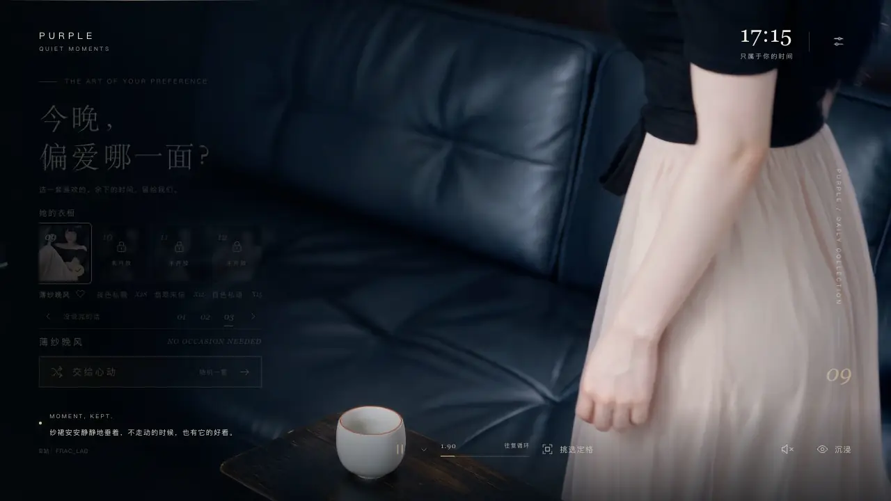

# Hinata Moment（PURPLE · 片刻）

> 一张会陪你换装的桌面互动壁纸 —— macOS 版。

> [!NOTE]
> **原作**由 B 站 UP 主 **[FRAC_LAB](https://space.bilibili.com/7570868)** 开发。
> 本仓库是在原作基础上的**二次开发**，做了 Mac 版本；仓库作者**不是** FRAC_LAB 本人。
> 喜欢的话请去原作者主页支持：<https://space.bilibili.com/7570868>

<p align="center"></p>

**本仓库只提供 macOS 版**（macOS 12 及以上，Apple 芯片与 Intel 通用）：一个独立应用，下载 DMG 装上就能用，**不需要再装 Plash 或任何别的软件**。
Windows 用户请直接在 Wallpaper Engine（小红车）创意工坊搜索 **FRAC_LAB** 安装原作。

## 有什么

- 九套穿搭，可以点选、随机挑，或每隔一段时间自动换一套
- 默认来回往复播放，也可以定格在喜欢的那一秒
- 入场时有声音，之后安静陪着；切到别的应用时自动静音
- 画面铺满整块屏幕，垫在所有窗口和 Dock 下面，菜单栏与 Dock 自然透出壁纸的颜色；不改你的系统桌面图片
- 4K60 画质，可设为登录时自动启动

## 安装

1. 到 [Releases](https://github.com/opop32165455/mac-desktop-hinata/releases/latest) 下载 `HinataMoment-版本号-universal.dmg`（约 370MB）。
2. 打开 DMG，把 **Hinata Moment** 拖进「应用程序」，然后打开它。
3. 安装包没有经过 Apple 公证，第一次打开会被系统拦下：到「系统设置 → 隐私与安全性」往下翻，点「仍要打开」。只需要一次。

## 怎么用

应用运行时**不在 Dock 里显示图标**，入口是屏幕顶部菜单栏里的高跟鞋图标：

| 菜单项 | 作用 |
| --- | --- |
| 隐藏壁纸 / 展示壁纸 | 一键把壁纸藏起来并静音，再点一次恢复。快捷键 `Option + Shift + Command + H`，菜单项右侧也会显示 |
| 纯壁纸模式 | 不勾选（默认）：可以点击换装、改设置，会盖住桌面图标。勾选：界面全部收起，桌面图标露出来，画面不可点击 |
| 登录时自动启动 | 开机登录后自动运行 |
| ！功能说明 | 以上各项的说明 |
| 退出 | 关闭应用 |

- **换装、改设置**：在默认的可操作模式下直接点桌面上的界面；界面一段时间不动会自动收起，移动鼠标即恢复。
- **卸载**：菜单里先取消「登录时自动启动」并退出，再把「应用程序」里的 Hinata Moment 移到废纸篓。

## 自己打包

需要 [Rust](https://rustup.rs)、Node.js 和 Xcode 命令行工具。

```bash
npm install
```

```bash
npm run build
```

产物在 `src-tauri/target/universal-apple-darwin/release/bundle/dmg/`。细节见 [AGENTS.md](AGENTS.md) 的「独立应用」。

## 声明与致谢

原作由 B 站 UP 主 [FRAC_LAB](https://space.bilibili.com/7570868) 开发，版权归原作者所有。本仓库是基于原作的 Mac 版二次开发，作者与 FRAC_LAB 无关联。AI 生成，所有角色均为虚构。
